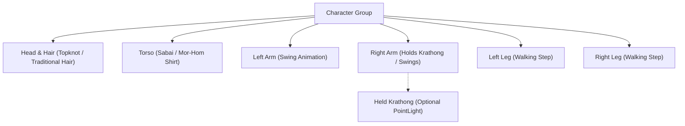

# แผนการพัฒนา: ระบบท่าน้ำและฝูงชนร่วมงานเทศกาลลอยกระทง (Pier & Festival Crowd Simulation)

เอกสารแผนงานสถาปัตยกรรม การออกแบบ 3D และขั้นตอนการพัฒนาส่วนต่อขยาย **ท่าน้ำไทยริมน้ำ (Waterfront Pier)** และ **ระบบผู้คนเดินร่วมงานเทศกาล (Festival Crowd Simulation)** เพื่อเพิ่มความมีชีวิตชีวาและบรรยากาศสมจริงให้กับเว็บไซต์ลอยกระทงออนไลน์

---

## 1. วัตถุประสงค์ (Objective)

ยกระดับบรรยากาศของเว็บไซต์จากริมน้ำที่เงียบสงบ ให้กลายเป็น **"งานเทศกาลลอยกระทงที่มีผู้คนมาร่วมงานอย่างอบอุ่น"** โดย:
1. สร้าง **ท่าน้ำและสะพานไม้ริมน้ำ (Pier & Boardwalk)** ฝั่งที่ผู้เล่นยืนอยู่ เพื่อเป็นจุดชมวิวและจุดปล่อยกระทงที่ชัดเจน
2. สร้าง **ฝูงชนจำลอง (Animated 3D Crowd)** สวมชุดไทยประยุกต์เดินสวนกันไปมาบนทางเดินริมน้ำ บางคนถือกระทง บางคนก้มลงปล่อยกระทง และหยุดชมพลุ
3. รักษาประสิทธิภาพระดับ **60 FPS** บนเว็บเบราว์เซอร์ทั้งคอมพิวเตอร์และโทรศัพท์มือถือ

---

## 2. องค์ประกอบสถาปัตยกรรม 3D (3D Architectural Design)

```
+-------------------------------------------------------------------------------+
|                             (แม่น้ำเจ้าพระยา / เจดีย์ทอง)                          |
|   ~~~~~~~~~~~~~~~~~~~~~~~~~~~~~~~~~~~~~~~~~~~~~~~~~~~~~~~~~~~~~~~~~~~~~~~~~   |
|         [กระทงลอยน้ำ]          [โป๊ะลอยน้ำ / บันไดเทียบผิวน้ำ]                      |
|                                     |                                         |
|   ==================================+======================================   |
|   [ศาลาริมน้ำ]    <--- คนเดินสวนกันไปมา --->    [สะพานไม้ท่าน้ำ]   [เสาโคมไฟโบราณ]    |
|   [ม้านั่งพักผ่อน]   (NPC ถือกระทง / ยืนดูพลุ)    (NPC ก้มปล่อยกระทง)                 |
|   =========================================================================   |
|                   ทางเดินริมน้ำเลียบแม่น้ำ (Promenade Boardwalk)                 |
+-------------------------------------------------------------------------------+
```

### 2.1 ท่าน้ำและสะพานไม้ (Waterfront Pier & Promenade)
* **ทางเดินริมน้ำ (Wooden Boardwalk / Promenade):**
  * ทางเดินไม้กระดานสักกว้าง 6 เมตร ทอดยาวเลียบแนวแม่น้ำ
  * ราวระเบียงไม้ฉลุลายไทยโบราณ พร้อมเสาโคมไฟแขวนเรืองแสงสีส้มอุ่นทุกๆ 8 เมตร
* **สะพานท่าน้ำยื่นลงสู่แม่น้ำ (Pier Pierhead & Jetty):**
  * สะพานไม้ยื่นออกไปในแม่น้ำประมาณ 8-10 เมตร มีเสาไม้ปักลงในน้ำ
  * ปลายสะพานมี **บันไดไม้ 4 ขั้นทอดยาวลงสู่ระดับผิวน้ำ** สำหรับเป็นจุดปล่อยกระทงของผู้เล่นและตัวละคร
  * เสาผูกเรือพร้อมเชือกมนิลาและห่วงทองเหลืองโบราณ
* **ศาลาริมน้ำและจุดนั่งพัก (Rest Pavilion):**
  * ศาลาไม้โปร่งทรงไทยประยุกต์สำหรับผู้มาร่วมงานนั่งพักผ่อน
  * กระถางดอกบัวหลวงและกอดอกไม้น้ำประดับริมฝั่ง

---

## 3. การออกแบบระบบฝูงชนจำลอง (Festival Crowd Simulation)

### 3.1 รูปแบบโมเดลตัวละคร (Stylized Low-Poly Characters)
เพื่อไม่ให้กินทรัพยากรเครื่องของผู้ใช้ ตัวละครจะถูกสร้างเป็นสไตล์ **Low-Poly Stylized Thai Costumes** ประกอบด้วย:
* **ความหลากหลายของตัวละคร (Character Variations):**
  * **หญิงชุดไทยสไบเฉียง / ผ้าถุง:** โทนสีกรีบบัว (ชมพู), สีทองนวล, และสีฟ้าคราม
  * **ชายสวมเสื้อม่อฮ่อม / ผ้าขาวม้าคาดเอว:** โทนสีครามและสีกรมท่า
  * **ชาย/หญิงชุดไทยประยุกต์สมัยใหม่:** กางเกง/กระโปรงสุภาพร่วมสมัย
* **พร็อพประจำตัว (Props & Accessories):**
  * NPC บางคนถือ **กระทงจิ๋วมีแสงเทียน** อยู่ในมือ เดินมุ่งหน้าไปยังท่าน้ำ
  * NPC บางคนถือ **โคมไฟกระดาษ** ส่องสว่างทางเดิน



### 3.2 พฤติกรรมและเส้นทางเดินของ AI (AI Behaviors & Waypoints)
ตัวละครในฉากจะถูกควบคุมด้วย **State Machine & Waypoint System**:

1. **State 1: Walking (เดินสัญจรไปมา)**
   * เดินตามแกน X ของทางเดินริมน้ำ (จากซ้ายไปขวา หรือขวาไปซ้าย)
   * ก้าวขาและแกว่งแขนแบบ Procedural Sine Oscillation ตามจังหวะความเร็วเดิน
2. **State 2: Heading to Pier (เดินไปท่าน้ำเพื่อลอยกระทง)**
   * ตัวละครที่ถือกระทงจะเลี้ยวเข้าสู่สะพานไม้ เดินลงไปที่ปลายบันไดท่าน้ำ
3. **State 3: Releasing Krathong (ก้มลงลอยกระทง)**
   * ตัวละครย่อตัว/คุกเข่าลงที่ขั้นบันไดริมน้ำ วางกระทงลงบนผิวน้ำ กระทงจะเริ่มลอยออกไปสู่แม่น้ำจริง
   * ยืนขึ้น พนมมือไหว้อธิษฐาน 2-3 วินาที แล้วเดินกลับขึ้นมาบนทางเดิน
4. **State 4: Gazing at Sky (หยุดชมพลุและพระจันทร์)**
   * เมื่อมีพลุแตกบนท้องฟ้า NPC บางคนจะสุ่มหยุดเดิน แล้วแหงนหน้ามองท้องฟ้า 3-5 วินาที ก่อนเดินต่อ

---

## 4. สถาปัตยกรรมโค้ดและโครงสร้างไฟล์ใหม่ (Code Architecture)

```text
js/
├── scene/
│   ├── Pier.js              # [ใหม่] โครงสร้าง 3D สะพานท่าน้ำ ราวระเบียง บันได และศาลา
│   ├── Pagoda.js            # พระเจดีย์ฝั่งตรงข้าม
│   └── ...
├── entities/
│   ├── Character.js         # [ใหม่] โมเดลตัวละคร Low-Poly ชุดไทย + แอนิเมชันขาก้าว/แขนแกว่ง
│   ├── CrowdManager.js      # [ใหม่] จัดการฝูงชน Waypoint เส้นทางเดิน และการเกิด/สุ่มพฤติกรรม
│   ├── Krathong.js          # โมเดลกระทง 3D
│   └── RiverFlow.js         # กระแสน้ำและการไหล
└── audio/
    └── SoundManager.js      # เพิ่มเสียงบรรยากาศฝูงชนงานวัดเบาๆ (Crowd Murmur Ambient)
```

---

## 5. การปรับแต่งประสิทธิภาพ (Optimization Strategy for 60 FPS)

1. **Hierarchical Low-Poly Meshes:**
   * ตัวละคร 1 คนใช้โพลีกอนไม่เกิน 300-500 โพลี (ใช้รูปทรงกระบอก, กล่อง, และทรงกรวยตัด)
   * แชร์ Material ร่วมกัน (Color Palette Atlas / Shared MeshStandardMaterials) เพื่อลด Draw Calls
2. **Frustum Culling & Distance Culling:**
   * ตัวละครที่เดินหลุดพ้นขอบซ้าย-ขวาของหน้าจอ (นอกระยะสายตากล้อง) จะถูกสลับตำแหน่งวนลูปกลับมา (Object Pooling)
   * ตัวละครที่อยู่ไกลจะลดความถี่ในการคำนวณแอนิเมชัน (LOD Frame Skipping)
3. **Optimized Lighting:**
   * ไม่ใส่เงา (Shadow Caster) ให้กับตัวละครทุกตัว เพื่อประหยัดการประมวลผล GPU
   * ใช้แสงไฟจากโคมเสาริมน้ำส่องกระทบตัวละครแบบสถิตย์

---

## 6. ลำดับขั้นตอนการพัฒนา (Implementation Phases)

### ระยะที่ 1: สร้างโมเดล 3D ท่าน้ำและทางเดินริมน้ำ (`Pier.js`)
* [ ] ออกแบบพื้นทางเดินไม้กระดาน (Boardwalk) ริมฝั่งผู้เล่น
* [ ] สร้างสะพานท่าน้ำ (Pier) ยื่นลงไปในน้ำพร้อมบันไดไม้ 4 ขั้น
* [ ] ติดตั้งเสาโคมไฟไม้สไตล์ไทยโบราณพร้อมแสง PointLight อุ่นๆ
* [ ] ปรับตำแหน่งกล้องตั้งต้น (Dock View) ให้เห็นบรรยากาศท่าน้ำอย่างลงตัว

### ระยะที่ 2: สร้างโมเดลและแอนิเมชันตัวละคร 3D (`Character.js`)
* [ ] สร้างโมเดล Low-Poly ผู้หญิงชุดไทย (สไบ/ผ้าถุง) และผู้ชาย (เสื้อม่อฮ่อม/ชุดไทย)
* [ ] เขียนฟังก์ชันแอนิเมชัน Procedural เดิน (Swing Arms, Step Legs, Body Bobbing)
* [ ] สร้างโมเดลกระทงจิ๋วในมือตัวละครพร้อมแสงเทียน

### ระยะที่ 3: ระบบการเดินและ AI ฝูงชน (`CrowdManager.js`)
* [ ] กำหนดจุด Waypoints บนทางเดินริมน้ำและสะพานท่าน้ำ
* [ ] สร้างฝูงชนจำลองจำนวน 15-25 คน เดินสวนกันไปมาอย่างมีระเบียบ
* [ ] ใส่พฤติกรรมสุ่มให้ตัวละครเดินลงไปลอยกระทงที่ท่าน้ำ
* [ ] ซิงค์กระทงที่ NPC ปล่อยให้เข้าไปรวมในแม่น้ำสาธารณะ `RiverFlowManager`

### ระยะที่ 4: เสียงบรรยากาศงานวัดและเอฟเฟกต์เสริม
* [ ] เพิ่มเสียงแอมเบียนต์บรรยากาศงานเทศกาลเบาๆ (เสียงฝูงชนรื่นเริงห่างๆ) ใน `SoundManager.js`
* [ ] เชื่อมต่อปุ่มเปิด-ปิดเสียงเข้ากับ UI

---

*เอกสารฉบับนี้พร้อมนำไปเริ่มพัฒนาในโค้ดจริงได้ทันที*
